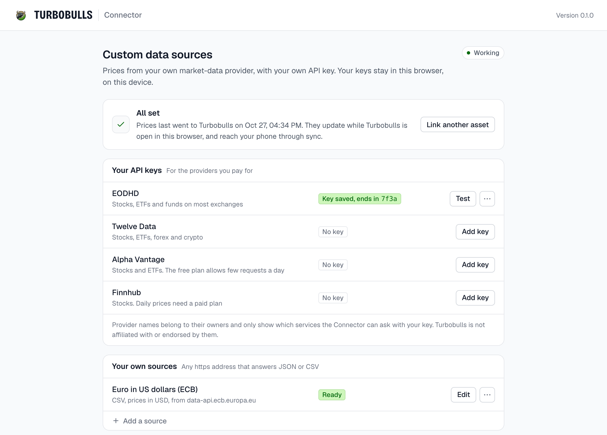
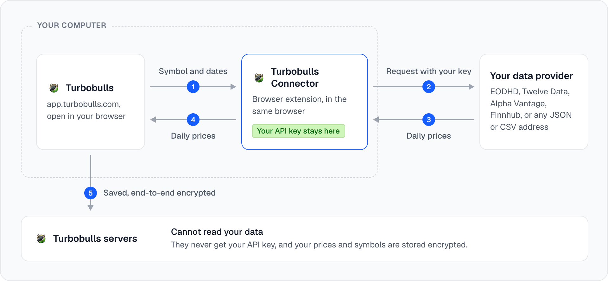
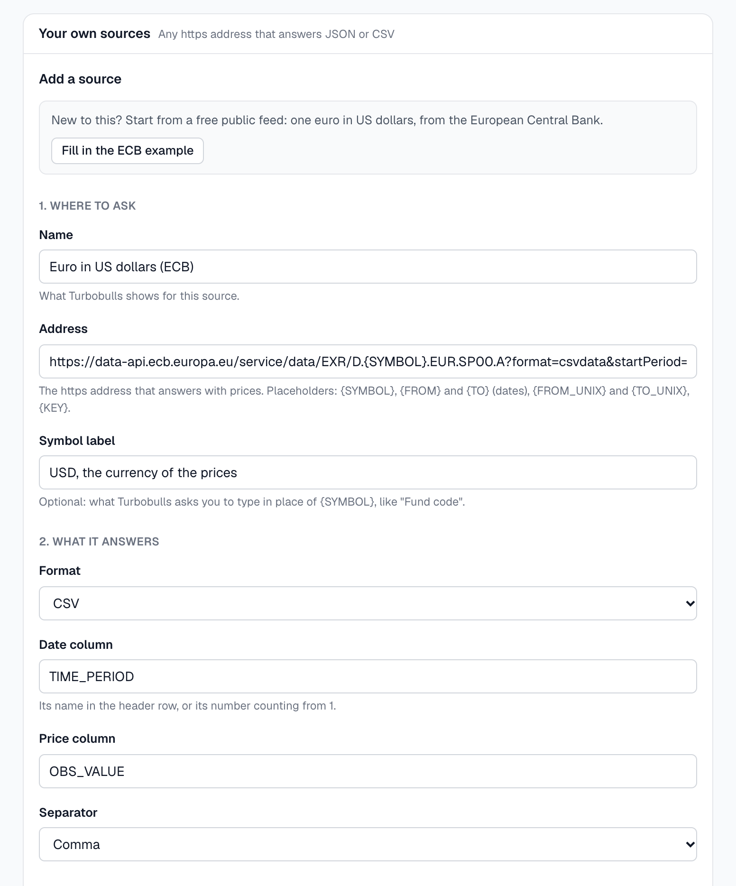

<p align="center">
  
</p>

<h1 align="center">Turbobulls Connector</h1>

<p align="center">
  <strong>Prices from your own market-data subscription, for <a href="https://turbobulls.com">Turbobulls</a>.</strong><br>
  A browser extension for Chrome and Edge. Your key goes only to your provider, and Turbobulls cannot read your data.
</p>

<p align="center">
  <a href="https://github.com/turbobullsapp/turbobulls-extension/actions/workflows/ci.yml"></a>
  <a href="LICENSE"></a>
  
  
</p>

<p align="center">
  <a href="#install">Install</a> ·
  <a href="#getting-started">Getting started</a> ·
  <a href="#privacy-and-security">Privacy and security</a> ·
  <a href="#your-own-sources">Your own sources</a> ·
  <a href="#faq">FAQ</a> ·
  <a href="#development">Development</a>
</p>

---

If you pay for a market-data provider, the Turbobulls Connector lets Turbobulls price the assets it
does not cover with that provider's data: a fund, a small exchange, a listing no free feed carries.
The app asks the extension, the extension asks your provider with your own key, and only the daily
prices come back.

> [!NOTE]
> **Nobody else sees your key or your data.** Your API key stays in this browser and goes only to
> your provider. Turbobulls never receives it and cannot read your data: the prices, and which
> assets you price, are saved end-to-end encrypted with the rest of your portfolio. See
> [who sees what](#who-sees-what) below.

<p align="center">
  <picture>
    <source media="(prefers-color-scheme: dark)" srcset="docs/images/settings-dark.png">
    
  </picture>
</p>

## Highlights

- **Your key never leaves your browser.** It is kept on this device only, never synced, and sent
  only to its own provider.
- **Turbobulls cannot read your data.** The prices, and which assets you price, are saved
  end-to-end encrypted with the rest of your portfolio.
- **No access to web pages.** No content scripts and no access to your tabs, Turbobulls included.
- **One website only.** Only `https://app.turbobulls.com` can talk to the extension, and only from
  the page itself, never from a frame.
- **Four providers built in**, plus any `https://` source of your own that answers JSON or CSV.
- **Small and auditable.** Open source, and the store packages are built from tagged commits by a
  public release workflow.

## How it works

<p align="center">
  <picture>
    <source media="(prefers-color-scheme: dark)" srcset="docs/images/how-it-works-dark.png">
    
  </picture>
</p>

The app and the extension speak a small, documented protocol (`hello`, `search`, `history` and
`openSettings`); see [PROTOCOL.md](PROTOCOL.md). Turbobulls keeps the prices in your workspace,
end-to-end encrypted, so your other devices (your phone included) receive them with the app's
normal sync, without an extension of their own.

## Install

| Browser | Get it |
|---|---|
| Google Chrome | Chrome Web Store (listing coming soon) |
| Microsoft Edge | Edge Add-ons (listing coming soon) |
| Firefox, or a program instead of an extension | [Turbobulls Connector app](https://github.com/turbobullsapp/turbobulls-bridge) |

Turbobulls talks only to the store version. A copy you load by hand gets a different extension id,
which the app does not know, on purpose: the app never trusts an id anyone could claim. To build
it yourself, see [Development](#development).

## Getting started

1. **Add your key.** Click the extension's icon. On the settings page that opens, press **Add key**
   next to your provider, paste its API key and press **Save and test**. The extension checks the
   key with one small request.
2. **Find the Connector in Turbobulls.** Open **Settings > Custom data sources**: the extension
   shows as ready, with the providers you set up.
3. **Price an asset.** Add a custom asset, choose **From a custom data source**, search for the
   symbol and pick it. Its prices fill in and stay up to date while Turbobulls is open in a
   browser with the extension.

What you can price depends on your plan with the provider.

## Providers it works with

| Provider | Covers | Notes |
|---|---|---|
| [EODHD](https://eodhd.com) | Stocks, ETFs and funds on most exchanges | |
| [Twelve Data](https://twelvedata.com) | Stocks, ETFs, forex and crypto | |
| [Alpha Vantage](https://www.alphavantage.co) | Stocks and ETFs | The free plan allows few requests a day |
| [Finnhub](https://finnhub.io) | Stocks | Daily prices need a paid plan |
| [A source of your own](#your-own-sources) | Anything an `https://` address returns as JSON or CSV | No search: you type the symbol |

EODHD, Twelve Data, Alpha Vantage and Finnhub are named only to show which services the Connector
can ask with your own key. Turbobulls is not affiliated with or endorsed by any of them, and your use
of each one is under your own plan and its terms.

## Privacy and security

### Who sees what

| | Your API key | Which assets you price | Your prices and portfolio |
|---|---|---|---|
| **Turbobulls' servers** | Never receive it | Cannot see them: stored encrypted | Cannot read them: stored encrypted |
| **This extension** | Keeps it on this device, and sends it only to your provider | Only the ones Turbobulls asks it to fetch | Passes the prices on; cannot read your portfolio |
| **Your data provider** | Checks it, as on any call to its API | Each symbol it is asked for | Sends the prices; never sees your portfolio |

The Turbobulls app decrypts your data in your browser, on your device: your portfolio and the
prices leave it only end-to-end encrypted.

### What the extension can do

The extension asks for as little as it can:

| Permission | Why |
|---|---|
| `storage` | To keep your API keys and your own sources on this device. Never synced to your browser account. |
| `eodhd.com`, `api.twelvedata.com`, `www.alphavantage.co`, `finnhub.io` | To call your provider's API. |
| Optional: one `https://` site at a time | Only when you add a source of your own, and only for its site. The browser asks you first; removing the source gives the permission back. |

- **It cannot read any web page.** It has no content scripts and no access to your tabs.
- **Only `https://app.turbobulls.com` can talk to it.** Other websites cannot even see that it is
  installed, and the extension checks again that each message comes from the app's own page.
- **The app can never send it a web address.** The app can only ask for a search or for prices
  from one of the four providers or from a source you added on the settings page, so the extension
  cannot be used to reach anything else. It never follows a redirect.
- **Your key goes only to its own provider**, in a header where the provider accepts one, and never
  appears in an answer, a message or a log.

Found a security problem? Please report it privately, as described in [SECURITY.md](SECURITY.md).

## Your own sources

For prices none of the four providers carry (a pension fund's daily price, a small exchange, a
spreadsheet you publish yourself), add a source on the settings page: any `https://` address that
answers JSON or CSV. Give it a name, the address with placeholders (`{SYMBOL}`, `{FROM}`, `{TO}`,
`{FROM_UNIX}`, `{TO_UNIX}`, `{KEY}`), where the date and the price sit in the answer, the date
format, the currency, and a key if the source needs one. **Try it** fetches the last 30 days and
shows what it read, or why nothing matched.

New to this? **Fill in the ECB example** on the settings page sets up a free public feed to start
from: one euro in US dollars, from the European Central Bank.

<details>
<summary>See the form with the ECB example filled in</summary>
<br>
<p align="center">
  <picture>
    <source media="(prefers-color-scheme: dark)" srcset="docs/images/own-source-dark.png">
    
  </picture>
</p>
</details>

In Turbobulls the source appears among your custom data sources, without search: you type the
symbol, and the source's settings can say what to type ("Fund code"). Turbobulls sees the source's
name, never its address or key. Give the extension the address the data finally comes from, since
it never follows a redirect, and use only sources whose terms allow this use.

The settings mirror the Connector app's config format, described in full in
[its documentation](https://github.com/turbobullsapp/turbobulls-bridge/blob/main/docs/custom-sources.md).

## FAQ

<details>
<summary><strong>Does Turbobulls see my API key?</strong></summary>

No. The key stays in the extension's storage on this device and is sent only to its own provider.
The app receives prices, never the key.
</details>

<details>
<summary><strong>Can Turbobulls see which assets I price, or the prices?</strong></summary>

No. The link to your provider and the prices it sends are saved in your workspace with the rest of
your portfolio, end-to-end encrypted. Turbobulls' servers store them as ciphertext and cannot read
them.
</details>

<details>
<summary><strong>Do I need the extension on every device?</strong></summary>

No. One computer with the extension is enough. Turbobulls stores the prices in your workspace,
end-to-end encrypted, and your other devices, your phone included, receive them with the next
sync. Prices update while Turbobulls is open in a browser that has the extension.
</details>

<details>
<summary><strong>Which browsers are supported?</strong></summary>

Chrome and Edge. For Firefox, or if you prefer a program to an extension, use the
[Turbobulls Connector app](https://github.com/turbobullsapp/turbobulls-bridge).
</details>

<details>
<summary><strong>Why does the app not talk to a copy I built myself?</strong></summary>

The app knows only the store version's id. Any extension can claim an id in a development build,
so the app trusts only the published one. A development build answers a copy of the app running
at `http://localhost:3000` instead.
</details>

## Development

Requirements: Node.js 22 or newer and pnpm.

```bash
pnpm install
pnpm check        # typecheck, lint, test and store builds for Chrome and Edge
pnpm build:dev    # development build in .output/chrome-mv3-dev
pnpm dev-id       # print the development extension id
```

A development build also answers `http://localhost:3000` and always has the id
`flnofeaegigjpjinmbhlfgagajconknk`. That id is no secret: anyone can build an extension with it from
the public key in `src/dev-key.ts`, which is why the published app never talks to it. Store builds
have neither.

`pnpm dev` (live reload) adds permissions needed for reloading: never ship its output. The packages
uploaded to the stores are the ones the release workflow builds from a tagged commit and attaches
to a GitHub release. `pnpm zip` makes the same packages locally for testing only; never upload a
package built on your own computer.

The provider code in `src/shared/` is identical in the
[Connector app](https://github.com/turbobullsapp/turbobulls-bridge); a change there is made in both.

## Contributing

Issues and pull requests are welcome. Please read [CONTRIBUTING.md](CONTRIBUTING.md) first, and
report security problems privately as described in [SECURITY.md](SECURITY.md).

## License

The code is released under the [MIT License](LICENSE) © Turbobulls.

The Turbobulls name and logo are not covered by that license. If you publish a copy of the
extension, give it its own name and icon.

The settings page uses the [Geist](https://github.com/vercel/geist-font) and
[Bricolage Grotesque](https://github.com/ateliertriay/bricolage) fonts, under the SIL Open Font
License 1.1. Their license texts ship with the extension, in [public/licenses](public/licenses).
